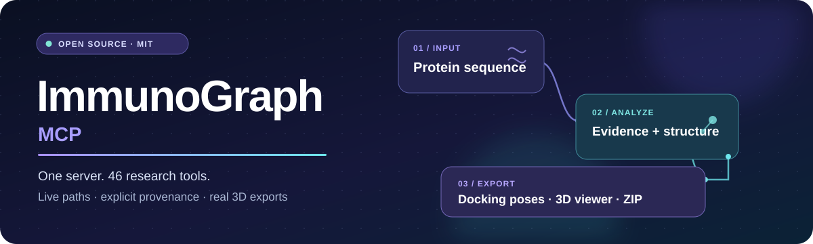
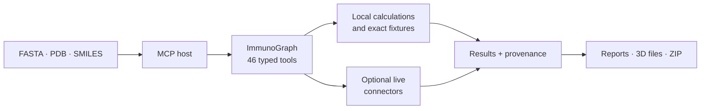
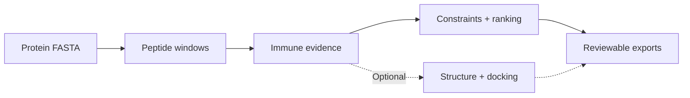
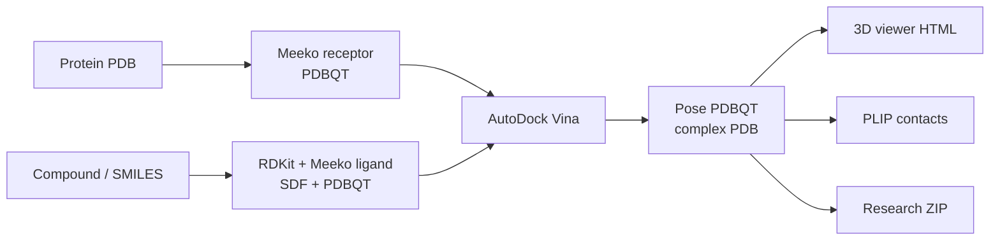

# ImmunoGraph MCP

<p align="center">
  
</p>

<p align="center">
  <a href="https://github.com/Ajey95/immuno-graph/actions/workflows/ci.yml"></a>
  <a href="https://github.com/Ajey95/immuno-graph/releases/tag/v0.2.0"></a>
  <a href="LICENSE"></a>
  <a href="docs/TOOL_CATALOG.md"></a>
  <a href="https://registry.modelcontextprotocol.io/v0/servers/io.github.Ajey95%2Fimmunograph/versions/0.2.0"></a>
</p>

**A standard Model Context Protocol server for computational epitope research.** Call 46 typed tools for sequence processing, immune evidence, structure and chemistry analysis, docking, and reviewable exports. Results carry provenance so a live provider result stays distinct from a fixture or synthetic demonstration.

[Get started](#get-started) · [How it works](#how-it-works) · [Docking and 3D files](#docking-and-3d-files) · [All 46 tools](docs/TOOL_CATALOG.md) · [Live setup](#enable-live-connectors) · [Contribute](CONTRIBUTING.md)

> [!IMPORTANT]
> ImmunoGraph supports **computational research**, not clinical or experimental validation. A predicted epitope, docking pose, score, or exported 3D model does not establish binding, vaccine efficacy, or safety. Fixture and synthetic results are demonstrations and are labelled as such.

## What you can do

| Explore | Analyze | Review and share |
| --- | --- | --- |
| Validate FASTA, generate peptide windows, retrieve PDB structures and PubChem compounds | Call enabled IEDB predictors; calculate consensus and coverage; run RDKit, FreeSASA, fpocket, Meeko, Vina, and PLIP where installed | Rank caller-supplied evidence; export CSV, PDB, SDF, PDBQT, docking poses, Mol* or docking viewers, and a checksummed research ZIP |

This is **one server with 46 tools**, not 46 independent live data providers. Each tool is callable on its own. A client passes results between calls when building a workflow.

## Get started

### Install the public release

Node.js 20 or newer is required. The versioned tarball is hosted on GitHub and installs with npm; the `immunograph-mcp` name is **not yet published on the npm registry**.

```bash
npm install --global https://github.com/Ajey95/immuno-graph/releases/download/v0.2.0/immunograph-mcp-0.2.0.tgz
```

Register the installed command in an MCP host that supports stdio servers:

```json
{
  "mcpServers": {
    "immunograph": {
      "command": "immunograph-mcp"
    }
  }
}
```

The server speaks MCP on stdio, so launch it through your host. If the host cannot find the globally installed command, configure its absolute path. The [GitHub release](https://github.com/Ajey95/immuno-graph/releases/tag/v0.2.0) also includes the source and the tarball's SHA-256 checksum. The public tarball was downloaded, hash-checked, installed, and called through a standard MCP client.

### Run the public container

The [official MCP Registry entry](https://registry.modelcontextprotocol.io/v0/servers/io.github.Ajey95%2Fimmunograph/versions/0.2.0) points to the public OCI image. For a local stdio host, use:

```json
{
  "mcpServers": {
    "immunograph": {
      "command": "docker",
      "args": [
        "run", "--rm", "-i",
        "ghcr.io/ajey95/immuno-graph:0.2.0",
        "node", "dist/index.js"
      ]
    }
  }
}
```

The container also supports guarded Streamable HTTP at `/mcp`. See [HTTP deployment](#http-deployment) for its required security settings.

### Build from source

```bash
git clone https://github.com/Ajey95/immuno-graph.git
cd immuno-graph
npm ci
npm run check
npm start
```

`npm start` serves stdio MCP. `npm run check` runs the software tests, build, all-tool example calls, semantic audit, dependency audit, and package dry run. For a host, point `command` at `node` and `args` at the absolute path to `dist/index.js`.

## How it works



The host chooses which tools to call. ImmunoGraph validates typed inputs, executes a handler, and returns structured success or failure data with run metadata and source labels. The server does not silently run a full study or treat fixture values as live evidence. See [architecture](docs/ARCHITECTURE.md) for transport and module details.

### A research workflow



These are **separate MCP calls**. Rankings and reports depend on the evidence the client supplies. With live prediction disabled, an arbitrary new protein has no automatic scientific binding result.

## Docking and 3D files

Configured live tools can use actual coordinates rather than decorative models:



The [live docking guide](docs/LIVE_WORKFLOWS.md) documents inputs, runtime requirements, example files, and verification of the exported pose chain. A 3D viewer visualizes returned coordinate data; it is not evidence of experimental binding. [Download the example docking research package](research-package-actual-docking-full.zip) to inspect its included files.

## Provenance you can inspect

| Result path | Meaning | Scientific use |
| --- | --- | --- |
| `LIVE` | A configured external provider or local scientific runtime executed on supplied inputs | Review its method, parameters, and limitations |
| `FIXTURE` | An approved, exact-match offline replay | Demonstration only |
| `SYNTHETIC` | Deterministic teaching data generated by a demo tool | Demonstration only |
| Caller-supplied calculations | Ranking, constraints, calibration, and reporting transform supplied evidence | Depends on the quality and provenance of that evidence |

The [46-tool reality matrix](docs/TOOL_REALITY_MATRIX.md) records what each tool actually computes or fetches and the verification performed. In particular, GraphBepi is fixture-only in this release; Parker is a hydrophilicity calculation; BepiPred-3.0 is the supported live B-cell option when enabled.

## Tool catalog

| Group | Tools | Examples |
| --- | ---: | --- |
| Prediction | 6 | FASTA validation, peptide windows, MHC-I/II, B-cell |
| Evidence and prioritization | 9 | Score normalization, consensus, HLA coverage, ranking |
| Constraints | 5 | Overlap, duplicates, thresholds, candidate rules |
| Structure | 7 | RCSB/AlphaFold, accessibility, pockets, Mol* |
| Chemistry | 5 | PubChem, RDKit descriptors, ligand preparation |
| Docking | 5 | Receptor preparation, Vina, pose clustering, PLIP |
| Reports and utilities | 9 | CSV/report data, explanations, workflow trace, ZIP |
| **Total** | **46** | **One MCP server** |

See the [complete tool catalog](docs/TOOL_CATALOG.md) and [input contracts](src/modules/tool-contracts.ts). To try one call, invoke `validate_sequence` with:

```json
{
  "fasta": ">protein\nACDEFGHIK",
  "profileVersion": "mvp-v1.0"
}
```

It returns the normalized sequence, length, and SHA-256 identity, or a structured validation error.

## Enable live connectors

Most live connectors are disabled by default. Set flags in the MCP server's environment and install the relevant provider runtime or allow its network endpoint. [`.env.example`](.env.example) lists the settings.

| Capability | Switch | Additional requirement |
| --- | --- | --- |
| IEDB MHC-I/II, BepiPred-3.0, population coverage | `IEDB_LIVE_ENABLED`, `IEDB_BCELL_ENABLED`, `IEDB_POPULATION_COVERAGE_ENABLED` | Access to the relevant IEDB APIs |
| RCSB PDB, AlphaFold DB, PubChem | `RCSB_PDB_ENABLED`, `ALPHAFOLD_DB_ENABLED`, `PUBCHEM_ENABLED` | Provider network access |
| RDKit, Meeko, FreeSASA, fpocket | See [environment configuration](src/modules/config/environment.ts) | Installed Python packages or native binaries |
| AutoDock Vina and PLIP | `VINA_ENABLED`, `PLIP_ENABLED` | Installed runtimes and valid coordinate inputs |

If a required provider or binary is unavailable, the tool returns an explicit failure or a labelled fallback according to the requested policy. The npm tarball and container do not bundle optional scientific binaries or model downloads.

### HTTP deployment

`npm run start:http` serves `http://127.0.0.1:3000/mcp` locally, with `GET /health` as a health probe. For a remote endpoint, set `HOST=0.0.0.0`, a long `IMMUNOGRAPH_API_KEY`, exact `IMMUNOGRAPH_ALLOWED_HOSTS` and `IMMUNOGRAPH_ALLOWED_ORIGINS`, and terminate TLS at your ingress. The image runs the HTTP entry point by default; publishing the image does not create a managed endpoint. Read [SECURITY.md](SECURITY.md) before deployment.

## Verification and scope

The [CI workflow](https://github.com/Ajey95/immuno-graph/actions/workflows/ci.yml) checks Windows and Linux on Node.js 20 and 22. A standard MCP client has exercised all 46 documented examples; the semantic audit checks calculations, provenance, and artifact hashes. The [container release run](https://github.com/Ajey95/immuno-graph/actions/runs/41224817115) tested 46-tool discovery and a real call over Docker stdio, guarded HTTP, and a test TLS ingress. These checks establish software behavior and packaging, not the accuracy of every scientific method or continuous availability of third-party services.

The motivation is familiar in epitope research: studies such as [Grifoni et al. (2020)](https://doi.org/10.1016/j.chom.2020.03.002) and [Ferreira et al. (2021)](https://pmc.ncbi.nlm.nih.gov/articles/PMC8641484/) combine sequence analysis, prediction, conservation, and other evidence across tools. ImmunoGraph makes computational handoffs easier to inspect; independent review and experimental validation remain necessary.

## Contribute and get help

Contributions and reproducible bug reports are welcome. Start with [CONTRIBUTING.md](CONTRIBUTING.md), open an [issue](https://github.com/Ajey95/immuno-graph/issues), and report security concerns through [SECURITY.md](SECURITY.md). Released changes are in [CHANGELOG.md](CHANGELOG.md). ImmunoGraph is available under the [MIT license](LICENSE).
