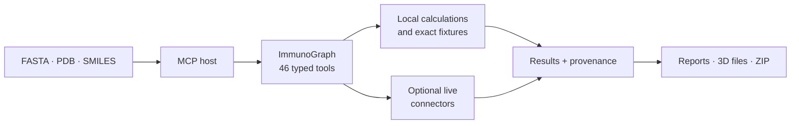
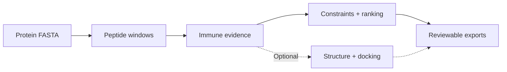
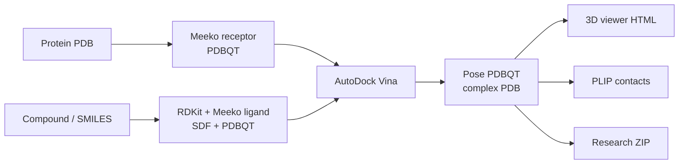
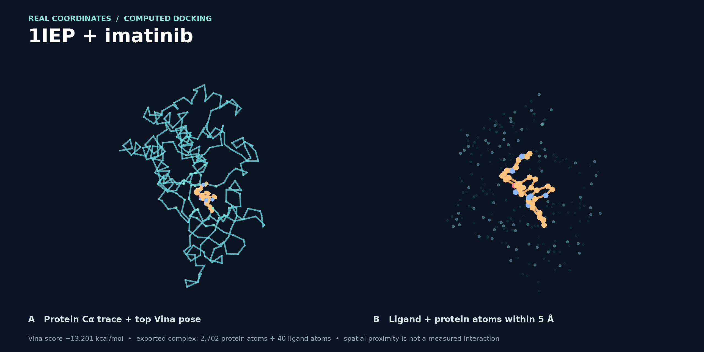
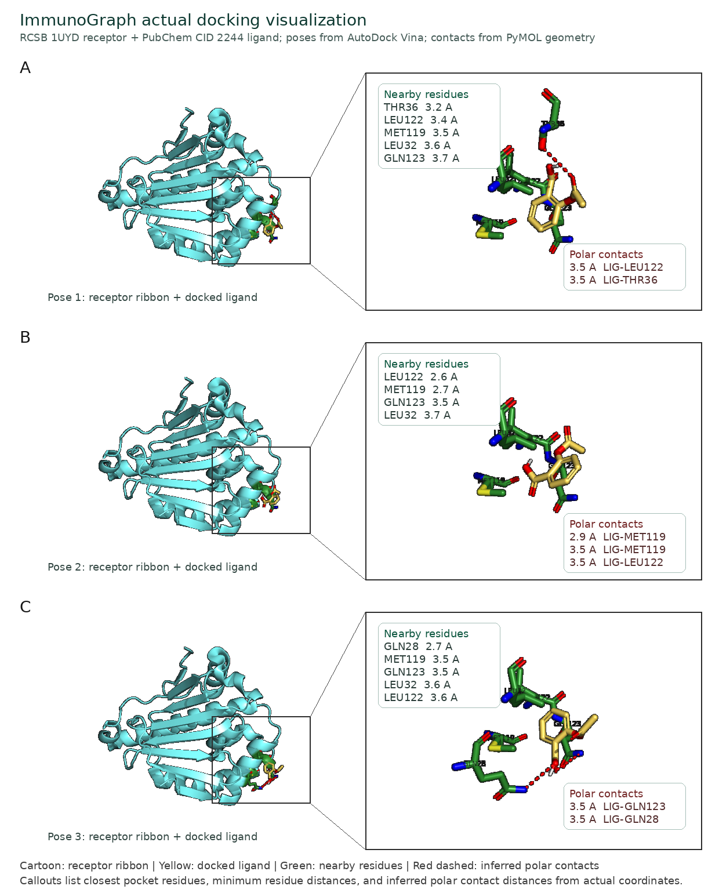

# ImmunoGraph MCP

<p align="center">
  
</p>

<p align="center">
  <a href="https://github.com/Ajey95/immuno-graph/actions/workflows/ci.yml"></a>
  <a href="https://github.com/Ajey95/immuno-graph/releases/tag/v0.2.1"></a>
  <a href="LICENSE"></a>
  <a href="docs/TOOL_CATALOG.md"></a>
  <a href="https://registry.modelcontextprotocol.io/v0/servers/io.github.Ajey95%2Fimmunograph/versions/0.2.1"></a>
</p>

**A standard Model Context Protocol server for computational epitope research.** Call 46 typed tools for sequence processing, immune evidence, structure and chemistry analysis, docking, and reviewable exports. Results carry provenance so a live provider result stays distinct from a fixture or synthetic demonstration.

[Problem](#the-problem) · [Who it is for](#who-it-is-for) · [User flow](#user-flow) · [Get started](#get-started) · [3D outcomes](#real-3d-outcomes) · [All 46 tools](docs/TOOL_CATALOG.md) · [Contribute](CONTRIBUTING.md)

> [!IMPORTANT]
> ImmunoGraph supports **computational research**, not clinical or experimental validation. A predicted epitope, docking pose, score, or exported 3D model does not establish binding, vaccine efficacy, or safety. Fixture and synthetic results are demonstrations and are labelled as such.

## The problem

An epitope research workflow crosses different kinds of software: sequence processing, immune predictors, HLA coverage, structure databases, molecular preparation, docking, interaction analysis, and reporting. Each step has its own input format, runtime, and scientific assumptions. When an LLM or research application chains them together, it must also keep track of *which inputs and methods produced each result*. A plausible looking score or 3D view is easy to misread if its source is missing.

ImmunoGraph gives an MCP host one typed interface for these steps. The host can discover and call individual tools, pass outputs between them, and inspect explicit source labels and exported bytes. This reduces custom integration code for a **reviewable computational workflow**; it does not replace scientific judgment or validate a prediction by itself.

## Who it is for

| Audience | Typical use |
| --- | --- |
| Computational immunology and vaccine research teams | Assemble and review sequence, MHC, B-cell, coverage, and structural evidence for candidate exploration |
| Structural bioinformatics and medicinal chemistry researchers | Prepare coordinates, run configured docking tools, inspect poses and contacts, and export the actual files |
| Developers building LLM research assistants | Expose typed scientific operations through standard MCP instead of writing a separate adapter for every step |
| Educators and reproducibility reviewers | Demonstrate a workflow with clearly marked fixtures, then inspect method boundaries, provenance, and artifacts |

The outputs are for research and education. Clinical decisions, efficacy claims, and experimental validation require independent methods and evidence.

## What you can do

| Explore | Analyze | Review and share |
| --- | --- | --- |
| Validate FASTA, generate peptide windows, retrieve PDB structures and PubChem compounds | Call enabled IEDB predictors; calculate consensus and coverage; run RDKit, FreeSASA, fpocket, Meeko, Vina, and PLIP where installed | Rank caller-supplied evidence; export CSV, PDB, SDF, PDBQT, docking poses, Mol* or docking viewers, and a checksummed research ZIP |

This is **one server with 46 tools**, not 46 independent live data providers. Each tool is callable on its own. A client passes results between calls when building a workflow.

## User flow

The researcher works in an MCP-enabled chat or application. The **client chooses the calls and carries evidence forward**; ImmunoGraph executes each requested operation and returns a typed result.

| Step | Researcher or client action | ImmunoGraph response |
| --- | --- | --- |
| 1. Connect | Add the stdio server to an MCP host; enable only the live connectors needed for the study | The host discovers 46 tools and their input schemas |
| 2. Define inputs | Provide a FASTA sequence and study criteria | `validate_sequence` checks and hashes the sequence; `generate_candidate_peptides` enumerates real peptide windows |
| 3. Gather evidence | Request available MHC-I/II, B-cell, population, or other calculations | Each call returns scores or a structured failure with source status; live predictors require their configured service |
| 4. Prioritize | Pass selected evidence, thresholds, and coverage data into the scoring and constraint tools | Normalized scores, consensus, exclusions, and ranked candidates depend on the supplied evidence |
| 5. Inspect structure | Optionally fetch PDB/compound data and run accessibility, pocket, ligand, docking, or contact tools | Coordinate-based outputs, pose files, 3D viewer HTML, and analysis data where the scientific runtime is installed |
| 6. Review and export | Inspect source labels and parameters, then request reports, CSV, trace, or research ZIP | File bytes with lengths and SHA-256 hashes for independent saving and verification |

This flow is **modular**: a user can call one tool without running every stage. `run_agentic_workflow` executes caller-supplied, approved tool calls; without those calls it returns a plan rather than silently launching a full study. See [architecture](docs/ARCHITECTURE.md) and the [tool reality matrix](docs/TOOL_REALITY_MATRIX.md) for exact execution boundaries.

## Get started

### Install the public release

Node.js 20 or newer is required. The versioned tarball is hosted on GitHub and installs with npm; the `immunograph-mcp` name is **not yet published on the npm registry**.

```bash
npm install --global https://github.com/Ajey95/immuno-graph/releases/download/v0.2.1/immunograph-mcp-0.2.1.tgz
```

Register the installed command in an MCP host that supports stdio servers:

```json
{
  "mcpServers": {
    "immunograph": {
      "command": "immunograph-mcp"
    }
  }
}
```

The server speaks MCP on stdio, so launch it through your host. If the host cannot find the globally installed command, configure its absolute path. The [GitHub release](https://github.com/Ajey95/immuno-graph/releases/tag/v0.2.1) also includes the source and a SHA-256 checksum for the tarball. The downloaded public tarball matched that checksum.

### Run the public container

The [official MCP Registry entry](https://registry.modelcontextprotocol.io/v0/servers/io.github.Ajey95%2Fimmunograph/versions/0.2.1) points to the public OCI image. For a local stdio host, use:

```json
{
  "mcpServers": {
    "immunograph": {
      "command": "docker",
      "args": [
        "run", "--rm", "-i",
        "ghcr.io/ajey95/immuno-graph:0.2.1",
        "node", "dist/index.js"
      ]
    }
  }
}
```

The container also supports guarded Streamable HTTP at `/mcp`. See [HTTP deployment](#http-deployment) for its required security settings.

### Build from source

```bash
git clone https://github.com/Ajey95/immuno-graph.git
cd immuno-graph
npm ci
npm run check
npm start
```

`npm start` serves stdio MCP. `npm run check` runs the software tests, build, all-tool example calls, semantic audit, dependency audit, and package dry run. For a host, point `command` at `node` and `args` at the absolute path to `dist/index.js`.

## How it works



The host chooses which tools to call. ImmunoGraph validates typed inputs, executes a handler, and returns structured success or failure data with run metadata and source labels. The server does not silently run a full study or treat fixture values as live evidence. See [architecture](docs/ARCHITECTURE.md) for transport and module details.

### Technical design

| Concern | Implementation | Why it matters |
| --- | --- | --- |
| Client interoperability | Official MCP SDK; stdio for local hosts and guarded Streamable HTTP for deployments | One discoverable tool contract works across MCP-capable clients |
| Input and result contracts | Zod schemas, typed handlers, structured MCP results, explicit errors | Clients can validate arguments and handle failures programmatically |
| Scientific provenance | Source status, method/run metadata, and versioned exact-match fixtures | Reviewers can distinguish configured live work from offline demonstrations |
| Export integrity | Inline artifact bytes, byte lengths, and SHA-256 digests | A host can save actual PDB/PDBQT/CSV/ZIP files and verify them |
| Operational boundaries | Optional connectors and local scientific binaries are configured separately | Missing providers fail explicitly or use only the requested, labelled fallback |

The registry entry points to the published OCI image. Optional scientific binaries, model downloads, and third-party service availability remain separate runtime requirements.

### A research workflow



These are **separate MCP calls**. Rankings and reports depend on the evidence the client supplies. With live prediction disabled, an arbitrary new protein has no automatic scientific binding result.

## Docking and 3D files

Configured live tools can use actual coordinates rather than decorative models:



### Real 3D outcomes

**1IEP + imatinib: exported top Vina pose.** This figure is rendered from a [saved complex PDB](docs/examples/1iep-imatinib-vina-complex.pdb) produced by a `LIVE_ONLY` MCP docking call. Panel A traces the protein Cα coordinates and shows the ligand; panel B shows the ligand and protein atoms within 5 Å. The [render script](scripts/render-docking-example.py) reproduces the image from those coordinates. This is a docking capability example, not an epitope candidate; the pose score is a computational estimate, not measured affinity.



**1UYD + PubChem CID 2244: three computed poses.** This figure comes from the [live docking research ZIP](research-package-actual-docking-full.zip), which includes the receptor, ligand, Vina poses, complex, and image. Its [run provenance](docs/examples/docking-provenance.json) and [summary](docs/examples/docking-summary.json) identify the sources and nine generated poses; the image shows three of them. The callouts show distances calculated from the coordinates; dashed polar contacts are inferred geometry, not experimentally established bonds.

<p align="center"></p>

The [live docking guide](docs/LIVE_WORKFLOWS.md) documents inputs, runtime requirements, example files, and verification of the exported pose chain. An interactive 3D viewer visualizes returned coordinate data; neither image establishes experimental binding.

## Provenance you can inspect

| Result path | Meaning | Scientific use |
| --- | --- | --- |
| `LIVE` | A configured external provider or local scientific runtime executed on supplied inputs | Review its method, parameters, and limitations |
| `FIXTURE` | An approved, exact-match offline replay | Demonstration only |
| `SYNTHETIC` | Deterministic teaching data generated by a demo tool | Demonstration only |
| Caller-supplied calculations | Ranking, constraints, calibration, and reporting transform supplied evidence | Depends on the quality and provenance of that evidence |

The [46-tool reality matrix](docs/TOOL_REALITY_MATRIX.md) records what each tool actually computes or fetches and the verification performed. In particular, GraphBepi is fixture-only in this release; Parker is a hydrophilicity calculation; BepiPred-3.0 is the supported live B-cell option when enabled.

## Tool catalog

| Group | Tools | Examples |
| --- | ---: | --- |
| Prediction | 6 | FASTA validation, peptide windows, MHC-I/II, B-cell |
| Evidence and prioritization | 9 | Score normalization, consensus, HLA coverage, ranking |
| Constraints | 5 | Overlap, duplicates, thresholds, candidate rules |
| Structure | 7 | RCSB/AlphaFold, accessibility, pockets, Mol* |
| Chemistry | 5 | PubChem, RDKit descriptors, ligand preparation |
| Docking | 5 | Receptor preparation, Vina, pose clustering, PLIP |
| Reports and utilities | 9 | CSV/report data, explanations, workflow trace, ZIP |
| **Total** | **46** | **One MCP server** |

See the [complete tool catalog](docs/TOOL_CATALOG.md) and [input contracts](src/modules/tool-contracts.ts). To try one call, invoke `validate_sequence` with:

```json
{
  "fasta": ">protein\nACDEFGHIK",
  "profileVersion": "mvp-v1.0"
}
```

It returns the normalized sequence, length, and SHA-256 identity, or a structured validation error.

## Enable live connectors

Most live connectors are disabled by default. Set flags in the MCP server's environment and install the relevant provider runtime or allow its network endpoint. [`.env.example`](.env.example) lists the settings.

| Capability | Switch | Additional requirement |
| --- | --- | --- |
| IEDB MHC-I/II, BepiPred-3.0, population coverage | `IEDB_LIVE_ENABLED`, `IEDB_BCELL_ENABLED`, `IEDB_POPULATION_COVERAGE_ENABLED` | Access to the relevant IEDB APIs |
| RCSB PDB, AlphaFold DB, PubChem | `RCSB_PDB_ENABLED`, `ALPHAFOLD_DB_ENABLED`, `PUBCHEM_ENABLED` | Provider network access |
| RDKit, Meeko, FreeSASA, fpocket | See [environment configuration](src/modules/config/environment.ts) | Installed Python packages or native binaries |
| AutoDock Vina and PLIP | `VINA_ENABLED`, `PLIP_ENABLED` | Installed runtimes and valid coordinate inputs |

If a required provider or binary is unavailable, the tool returns an explicit failure or a labelled fallback according to the requested policy. The npm tarball and container do not bundle optional scientific binaries or model downloads.

### HTTP deployment

`npm run start:http` serves `http://127.0.0.1:3000/mcp` locally, with `GET /health` as a health probe. For a remote endpoint, set `HOST=0.0.0.0`, a long `IMMUNOGRAPH_API_KEY`, exact `IMMUNOGRAPH_ALLOWED_HOSTS` and `IMMUNOGRAPH_ALLOWED_ORIGINS`, and terminate TLS at your ingress. The image runs the HTTP entry point by default; publishing the image does not create a managed endpoint. Read [SECURITY.md](SECURITY.md) before deployment.

## Verification and scope

The [CI workflow](https://github.com/Ajey95/immuno-graph/actions/workflows/ci.yml) checks Windows and Linux on Node.js 20 and 22. A standard MCP client has exercised all 46 documented examples; the semantic audit checks calculations, provenance, and artifact hashes. The [v0.2.1 container release run](https://github.com/Ajey95/immuno-graph/actions/runs/41230848366) tested 46-tool discovery and a real call over Docker stdio, guarded HTTP, and a test TLS ingress. The protocol audit also checks that every tool advertises parameter descriptions and a structured result schema. These checks establish software behavior and packaging, not the accuracy of every scientific method or continuous availability of third-party services.

The motivation is familiar in epitope research: studies such as [Grifoni et al. (2020)](https://doi.org/10.1016/j.chom.2020.03.002) and [Ferreira et al. (2021)](https://pmc.ncbi.nlm.nih.gov/articles/PMC8641484/) combine sequence analysis, prediction, conservation, and other evidence across tools. ImmunoGraph makes computational handoffs easier to inspect; independent review and experimental validation remain necessary.

## Contribute and get help

Contributions and reproducible bug reports are welcome. Start with [CONTRIBUTING.md](CONTRIBUTING.md), open an [issue](https://github.com/Ajey95/immuno-graph/issues), and report security concerns through [SECURITY.md](SECURITY.md). Released changes are in [CHANGELOG.md](CHANGELOG.md). ImmunoGraph is available under the [MIT license](LICENSE).
